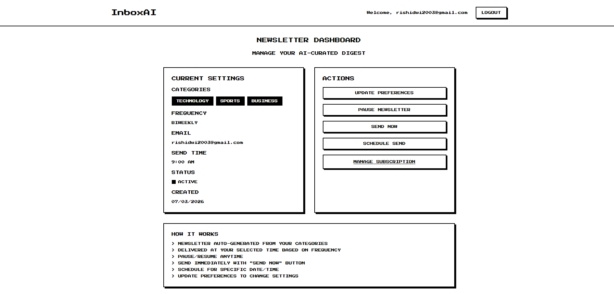

# InboxAI - Personalized Newsletter SaaS Platform

<div align="center">
  <div>
    
    
    
    
    
    
  </div>

  <h3 align="center">InboxAI - AI-Powered Newsletter SaaS with Next.js, Supabase & Groq</h3>
  

</div>

## 📋 <a name="table">Table of Contents</a>

1. 🤖 [Introduction](#introduction)
2. ⚙️ [Tech Stack](#tech-stack)
3. 🔋 [Features](#features)
4. 🚀 [Getting Started](#getting-started)
5. 🧭 [Known Limitations & Roadmap](#-known-limitations--roadmap)

## <a name="introduction">🤖 Introduction</a>

InboxAI is a sophisticated SaaS platform that automates the creation and delivery of personalized newsletters using artificial intelligence. Built from scratch with Next.js, Supabase, and Groq AI, it features secure user authentication, intelligent content curation, and automated scheduling. InboxAI enables users to receive AI-generated newsletters tailored to their chosen categories, powered by durable background workflows.

## <a name="tech-stack">⚙️ Tech Stack</a>

- **[Next.js](https://nextjs.org/)** is a powerful React framework that enables the development of fast, scalable web applications with features like server-side rendering, static site generation, and API routes for building full-stack applications.

- **[Supabase](https://supabase.com/)** is an open-source backend-as-a-service platform that provides instant APIs, real-time subscriptions, authentication, storage, and a PostgreSQL database, enabling developers to build scalable and secure applications with ease.

- **[Groq](https://groq.com/)** is a high-performance AI inference engine that provides ultra-fast language model processing, enabling real-time AI content generation with significantly lower latency than traditional solutions.

- **[Inngest](https://www.inngest.com/)** is a durable workflow engine that provides reliable background job processing with automatic retries, error handling, and event-driven architecture for mission-critical operations.

- **[Tailwind CSS](https://tailwindcss.com/)** is a utility-first CSS framework that allows developers to design custom user interfaces by applying low-level utility classes directly in HTML, streamlining the design process.

- **[TypeScript](https://www.typescriptlang.org/)** is a superset of JavaScript that adds static typing, providing better tooling, code quality, and error detection for developers, making it ideal for building large-scale applications.

- **[Nodemailer](https://nodemailer.com/)** is a Node.js library for sending email over SMTP. InboxAI uses it with a Gmail account (App Password) to deliver the newsletters.

- **[NewsAPI](https://newsapi.org/)** is a comprehensive news aggregation service that provides real-time access to news articles from thousands of sources worldwide, enabling dynamic content curation.

## <a name="features">🔋 Features</a>

👉 **AI-Powered Content Generation**: Groq-hosted LLaMA models (default `llama-3.1-8b-instant`, configurable via `GROQ_MODEL`) turn fetched news items into a concise HTML digest, grouped by category with a short summary under each linked headline.

👉 **Category Selection**: Choose from 8 news verticals (Technology, Business, Sports, Entertainment, Science, Health, Politics, Environment). Each category uses a tuned NewsAPI query with keyword exclusions and a list of trusted source domains.

👉 **Automated Scheduling**: Daily, weekly or bi-weekly delivery at a chosen send time. Each send schedules the next one through Inngest. Send times are currently interpreted in server time (UTC on Vercel); per-user timezones are on the roadmap.

👉 **Durable Workflow Management**: Newsletter generation runs as an Inngest function split into steps (check status, fetch news, summarize, render, send, schedule next), so failures retry from the failed step. Runs can be inspected in the Inngest dashboard.

👉 **Authentication & Preferences**: Supabase authentication with per-user preferences (categories, frequency, send time, email address) and the ability to pause or resume a newsletter.

👉 **Dashboard**: View your current preferences, send a newsletter immediately, schedule a one-off send, and pause or resume delivery.

👉 **Email Delivery**: Responsive, table-based HTML email template with a plain-text alternative and a `List-Unsubscribe` header, sent through Nodemailer over Gmail SMTP.

👉 **Modern UI/UX**: Custom retro-gaming aesthetic using Press Start 2P typography, pixelated components, and responsive layouts optimized for accessibility.

👉 **Database Security**: PostgreSQL on Supabase with Row Level Security policies on `user_preferences` (users can only read and write their own row), an index on `is_active`, and an `updated_at` trigger. Background jobs use a server-only service-role client.

👉 **Responsive UI**: Retro-gaming look built with Tailwind and the Press Start 2P font, usable on desktop and mobile.

👉 **Fallback Mechanisms**: If NewsAPI is rate-limited or returns nothing, the app retries with simpler queries and then top-headlines, and finally uses built-in fallback content. If Groq is unavailable or returns empty output, a plain digest is built from the raw article titles and descriptions, so a newsletter is still delivered.

👉 **Keep-alive Cron**: A daily Vercel Cron call to `/api/keep-alive` (protected by `CRON_SECRET`) keeps the free-tier Supabase project from being paused.

## 🧭 Known Limitations & Roadmap

- Per-user timezone support (send times are currently server time).
- Idempotency / de-duplication so re-saving preferences or pause/resume can never create overlapping schedules.
- Pass article descriptions to the model so summaries are grounded in more than the headline.
- Fetch and summarize once per category and reuse it across users to cut NewsAPI and Groq usage.
- A one-click unsubscribe flow and an email provider built for volume (Gmail SMTP has daily sending limits).
- Open and click analytics.

## <a name="getting-started">🚀 Getting Started</a>

**Prerequisites:** Node.js 20+, plus free accounts on [Supabase](https://supabase.com), [Groq](https://console.groq.com), [NewsAPI](https://newsapi.org) and a Gmail account with an [App Password](https://myaccount.google.com/apppasswords).

1. **Install dependencies**

   ```bash
   npm install
   ```

2. **Configure environment** – copy `.env.example` to `.env.local` and fill in the keys.

3. **Set up the database** – in the Supabase dashboard, open the SQL editor and run [`supabase/schema.sql`](supabase/schema.sql). Under *Authentication → URL Configuration*, add `http://localhost:3000` (and your production URL) to the redirect URLs.

4. **Run the app and the Inngest dev server** (two terminals)

   ```bash
   npm run dev
   ```

   ```bash
   npx inngest-cli@latest dev -u http://localhost:3000/api/inngest
   ```

   Open http://localhost:3000. The Inngest dashboard at http://localhost:8288 shows newsletter runs.

### Deploying (Vercel)

1. Import the repo in Vercel and add every variable from `.env.example`.
2. Install the [Inngest Vercel integration](https://www.inngest.com/docs/deploy/vercel) (or set `INNGEST_EVENT_KEY` / `INNGEST_SIGNING_KEY` manually) and sync the app at `https://<your-domain>/api/inngest`.
3. Add your production URL to Supabase's redirect URLs.

